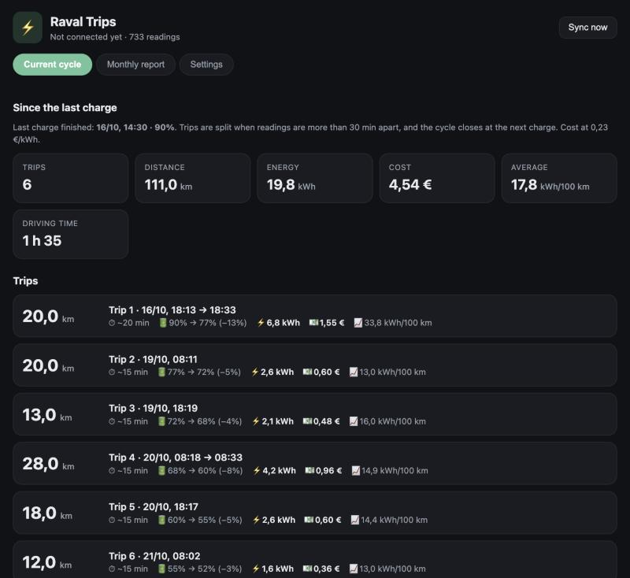
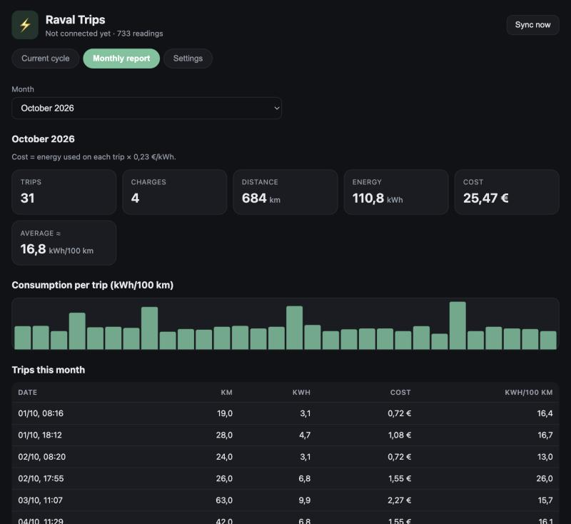

# Raval Trips

Trips, consumption and cost for your **CUPRA**, built from the data you request on the VW Group's EU Data Act
portal. **Everything stays on your computer:** no account with us, no cloud, no third-party API.

- **Current cycle:** the trips you made since the last charge, split whenever readings are more than 30 minutes apart.
  Distance, battery used, energy (kWh), cost and consumption per trip.
- **Monthly report:** trips, charges, distance, energy and cost per month, with totals and an approximate average
  consumption. Export to CSV.
- Works offline once the data is downloaded. Prices and battery size are yours to set.

> Unofficial project. It is not affiliated with CUPRA or the VW Group, and it relies on a community connector
> that can break if VW changes its portal. Energy and cost are **estimates** (battery % × capacity).

## Screenshots

*(Demo data, generated with `raval-trips demo`.)*





## Quick start

**1. Ask the portal for your data** (once) — see [docs/PORTAL_GUIDE.md](docs/PORTAL_GUIDE.md).

**2. Get the app** — no Python needed. Download it from the [latest release](https://github.com/jmap42591/raval-trips/releases/latest):

| System | File | First time you open it |
|---|---|---|
| **Windows 10/11** | `RavalTrips-windows.zip` | Unzip, open the folder, double-click `RavalTrips.exe`. If Windows SmartScreen warns about an unknown publisher, click **More info → Run anyway**. |
| **macOS** (Apple silicon) | `RavalTrips-macOS-arm64.dmg` | Drag *Raval Trips* to Applications. The first time, **right-click it → Open → Open** (the app is not signed with an Apple developer certificate). |

The dashboard opens in your browser at `http://127.0.0.1:8765`. Use **Settings → Quit Raval Trips** (or close the
console window on Windows) to stop it.

*Intel Mac, Linux, or you prefer Python?* Download this project (green **Code** button → **Download ZIP**), unzip it,
and double-click `install-and-run.command` (macOS) / `install-and-run.bat` (Windows), or run `./install-and-run.sh`
(Linux). This needs **Python 3.10 or newer** and installs everything on the first run.

**3. Connect your car**: enter your VW ID in the dashboard. The password is stored in your system's secure
vault (macOS Keychain, Windows Credential Locker) and only ever sent to VW. The app then syncs every 15 minutes while
it is running, and catches up on whatever it missed the next time you open it.

Don't want to type a password? Download the ZIP files from the portal yourself and import them under
**Settings → Import data files**.

## Where is my data?
- macOS: `~/Library/Application Support/raval-trips/`
- Windows: `%APPDATA%\raval-trips\`
- Linux: `~/.local/share/raval-trips/`

`raval.sqlite` holds the readings and `settings.json` your preferences. Delete the folder to remove everything.

## Command line

```
raval-trips serve            # start the dashboard (default)
raval-trips import-zip *.zip # import files downloaded by hand
raval-trips sync             # download new files now
raval-trips report           # text report
raval-trips demo             # try the dashboard with fake data
```

## How trips and costs are calculated
- A **trip** is a run of odometer increases; a gap of more than 30 minutes (configurable) starts a new trip.
- A **cycle** is everything between two charges; a charge is detected from the battery level rising
  while the car is not driving (or from the car reporting that it is charging).
- **Energy** = battery % used × battery capacity. **Cost** = energy × your price per kWh. Charger losses are
  not included, so a real bill is typically ~10 % higher.
- Timestamps are approximate: the car reports about every 15 minutes, and with some delay.

## Limits
- No window/door alerts (the portal does not provide them for the Raval).
- The portal's file list is a rolling window; if the app is closed for longer than that, older readings are lost.
- Battery percentage comes in 1 % steps, so short trips have rough consumption numbers.

## Development
```
python -m venv .venv && .venv/bin/pip install -e .
PYTHONPATH=src python -m unittest discover -s tests
PYTHONPATH=src python -m raval_trips demo
```
The Windows and macOS apps are built with PyInstaller by `.github/workflows/build-apps.yml` whenever a version tag
(`v*`) is pushed. Redraw the icon with `python packaging/make_icon.py` (needs Pillow).

## Credits
Portal access uses [CarConnectivity-connector-vw-eu-data-act](https://github.com/mikrohard/CarConnectivity-connector-vw-eu-data-act)
(MIT) built on [CarConnectivity](https://github.com/tillsteinbach/CarConnectivity) by Till Steinbach.
